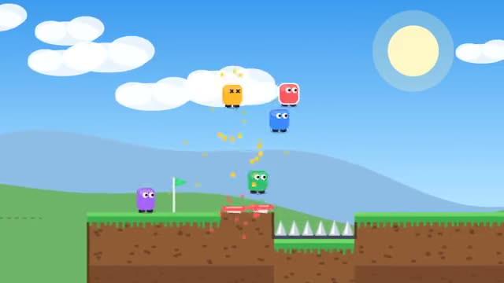

# Flag Rush

Race through the course. First to the flag wins. A multiplayer starter game from [Multiplayer Agent](https://multiplayeragent.com): 2D, versus, 2–8 players, with bots that fill empty seats.

## How it plays

Run, jump, ride moving platforms and bounce off springs past spikes and pits. Land on a rival's head to make them stumble, and grab the flag before anyone else. Every race strings together a new mix of course pieces.

**Controls:** Arrow keys or A/D and Space, or on-screen ◀ ▶ and Jump.

## Make it yours in the Game Builder

Open the [Game Builder](https://multiplayeragent.com), choose **Start from a starter game** and pick Flag Rush. It opens as version 1 in your studio, ready to play and publish. Then ask for changes, for example:

- Add a speed pad that makes you run twice as fast
- Make the course a lava cave with falling rocks
- Add a new course piece with a seesaw

## Run it yourself

1. Get a free publishable key (`pk_…`) at [multiplayeragent.com](https://multiplayeragent.com).
2. In `index.html`, put it in place of `pk_REPLACE_ME` in the `MP_CONNECT` block.
3. Open `index.html` in a browser. No build step and no server needed.

Without a key it still runs, offline against bots.

## How it is built

- One `index.html`. The comment at the top of the script maps the code and explains the multiplayer.
- The course pieces are drawn as text in `CHUNKS`: add or edit a piece and it shows up in the races.
- **Leaderboard:** The players who won the most races.
- **Host-run rounds:** The host's browser runs the countdown, calls the winner and starts the next race; if it leaves, the next player takes over.
- **Bots:** Bots race you and fill the start line until enough people join.
- **Live sync:** Every runner, jump and bonk shows up for everyone at once, on the same course.
- `?attract` runs it offline with bots only. The preview video is recorded from it.

## License

MIT.
